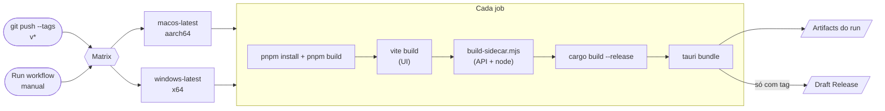

# Sentinel — Release do app desktop

[](https://github.com/SkDudu/sentinel/actions/workflows/desktop-release.yml)

Workflow: [`.github/workflows/desktop-release.yml`](../.github/workflows/desktop-release.yml)

> [!TIP]
> **Resumo:** `git tag v0.2.0 && git push --tags` → o GitHub Actions builda macOS + Windows em paralelo e abre um **release em rascunho** com os instaladores. Você revisa e clica em *Publish*.

---

## O que foi adicionado

| Peça | Arquivo | Papel |
| --- | --- | --- |
| 🧱 Workflow | `.github/workflows/desktop-release.yml` | Matrix macOS + Windows, cache Rust, `tauri-action` |
| 🟢 Sidecar Node | `apps/desktop/server/standalone.ts` | A mesma API do Vite rodando dentro do app empacotado |
| 📦 Empacotador do sidecar | `apps/desktop/scripts/build-sidecar.mjs` | esbuild da API + binário `node` do runner + `playwright-core` |
| 🦀 Shell Rust | `apps/desktop/src-tauri/src/lib.rs` | Sobe o sidecar, entrega porta/token à UI (`api_info`), mata no exit |
| 🎨 Ícones | `apps/desktop/src-tauri/icons/app-icon.svg` | Fonte única → `.icns`, `.ico`, PNGs |

---

## Fluxo



| Gatilho | Builda | Cria release | Onde baixar |
| --- | --- | --- | --- |
| Push de tag `v*` | ✅ | ✅ rascunho + prerelease | aba **Releases** |
| *Run workflow* (manual) | ✅ | — | aba **Actions** → run → *Artifacts* |

---

## Artefatos

| Plataforma | Arquivo | Tamanho aprox. | Assinado |
| --- | --- | --- | --- |
| 🍎 macOS (Apple Silicon) | `Sentinel_<versão>_aarch64.dmg` | ~45 MB | ❌ |
| 🪟 Windows (x64) | `Sentinel_<versão>_x64_en-US.msi` | ~40 MB | ❌ |
| 🪟 Windows (x64) | `Sentinel_<versão>_x64-setup.exe` (NSIS) | ~40 MB | ❌ |

O tamanho vem quase todo do runtime `node` embutido (necessário para `node:sqlite`).

---

## Como fazer um release

1. **Suba a versão** nos três lugares (precisam bater):
   - `apps/desktop/src-tauri/tauri.conf.json` → `"version"`
   - `apps/desktop/src-tauri/Cargo.toml` → `version`
   - `apps/desktop/package.json` → `"version"`
2. **Commit** na `main`: `chore(release): v0.2.0`
3. **Tag e push:**
   ```bash
   git tag v0.2.0
   git push origin main --tags
   ```
4. **Publique:** em *Releases*, abra o rascunho `Sentinel v0.2.0`, revise os anexos e clique em *Publish release*.

> [!NOTE]
> Quer só testar o build sem release? Aba **Actions** → *Desktop release* → *Run workflow*.

---

## Instalando build não assinado

Os builds ainda **não são assinados**. O sistema vai reclamar na primeira abertura — é esperado.

<details>
<summary><b>🍎 macOS</b> — "Sentinel está danificado e não pode ser aberto"</summary>

O Gatekeeper bloqueia apps baixados sem notarização. Depois de arrastar para *Aplicativos*:

```bash
xattr -cr /Applications/Sentinel.app
```

Ou: *Ajustes do Sistema* → *Privacidade e Segurança* → *Abrir mesmo assim*.

</details>

<details>
<summary><b>🪟 Windows</b> — "O Windows protegeu o computador"</summary>

O SmartScreen avisa em executáveis sem certificado. Clique em **Mais informações** → **Executar mesmo assim**.

O instalador baixa o WebView2 automaticamente se a máquina não tiver.

</details>

---

## Onde ficam os dados

| SO | Pasta |
| --- | --- |
| macOS | `~/Library/Application Support/dev.sentinel.desktop/` |
| Windows | `%APPDATA%\dev.sentinel.desktop\` |

Banco (`sentinel.db`), vault de secrets e `ai-settings.json` vivem ali. Desinstalar o app **não** apaga essa pasta.

---

## Limitações e próximos passos

| Item | Estado | Para resolver |
| --- | --- | --- |
| Assinatura macOS + notarização | ⏳ | Apple Developer (US$ 99/ano) + secrets `APPLE_*` no workflow |
| Assinatura Windows | ⏳ | Certificado de code signing + secrets no workflow |
| macOS Intel (`x86_64`) | ⏳ | `build-sidecar.mjs` usar o target do Tauri em vez do host do `rustc` |
| Linux (`.deb` / `.AppImage`) | ⏳ | Job `ubuntu-latest` + deps do WebKitGTK |
| Auto-update | ⏳ | `tauri-plugin-updater` + chave de assinatura do updater |

Detalhes do sidecar (porta aleatória, token por execução, `SENTINEL_DATA_DIR`) em [technologies.md](./technologies.md#tauri-build-nativo).
